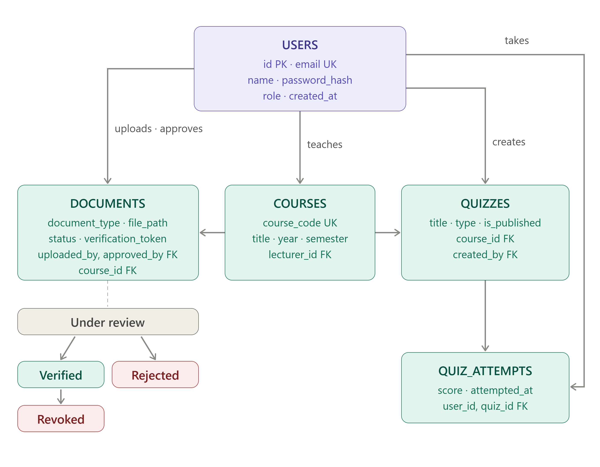

# 📚 LetLearnTogether: Open Student Past Papers & Library Platform


## 📖 Project Overview
**LetLearnTogether** is a mobile-first, phone-friendly web platform where students can find, read, download, and verify past examination papers, and practice multiple-choice quizzes. It replaces scattered, unverified chat files with a trusted, searchable, and moderated archive.

**Live Site:** [https://your-domain.com](https://your-domain.com) *(Update this when deployed)*  
**API Docs:** [https://your-domain.com/docs](https://your-domain.com/docs)

## 🛠️ Tech Stack & Infrastructure
*   **Frontend:** React + Vite (Progressive Web App)
*   **Backend:** Python + FastAPI
*   **Database:** MySQL
*   **OS & Deployment:** Ubuntu Linux, Docker (Containerized)
*   **Domain & DNS:** Cloudflare

## ## 📁 Documentation
All detailed project documentation is located in the `docs/` folder:
*   [Product Requirements Document (PRD)](docs/PRD.md)
*   [Software Requirements Specification (SRS)](docs/SRS.md)
*   [Database Architecture & ERD](docs/DATABASE_ARCHITECTURE.md)
*   [API Schema & Contract](docs/API_SPEC.yaml)
*   [User Manual](docs/USER_MANUAL.md)

##  System Architecture
Below is the visual blueprint of our database structure and document workflow:



## 🚀 Getting Started (Local Development)

### Prerequisites
Before you begin, ensure you have the following installed on your machine:
*   **Docker & Docker Compose** (Recommended for consistent environments)
*   **Node.js** (v18 or higher) - *If running frontend locally without Docker*
*   **Python** (v3.10 or higher) - *If running backend locally without Docker*
*   **Git**

### 1. Clone the Repository
```bash
git clone https://github.com/LetLearnTogether/library-platform.git
cd library-platform
```

### 2. Environment Variables (CRITICAL SECURITY RULE)
⚠️ **NEVER commit real passwords or API keys to GitHub.** 
We use a `.env.sample` file to show the required variables. You must create your own local `.env` files.

**Backend Setup:**
```bash
cd backend
cp .env.sample .env
# Open .env in a text editor and fill in your local MySQL credentials and JWT secret
```

**Frontend Setup:**
```bash
cd frontend
cp .env.sample .env.local
# Open .env.local and set VITE_API_BASE_URL=http://localhost:8000/api/v1
```

### 3. Run with Docker (Recommended)
Since our production environment is Ubuntu, we use Docker to ensure the app runs exactly the same on your laptop as it does on the server.
```bash
# From the root directory
docker-compose up --build
```

### 4. Run Locally (Without Docker)
**Backend:**
```bash
cd backend
python -m venv venv
source venv/bin/activate  # On Windows use: venv\Scripts\activate
pip install -r requirements.txt
uvicorn app.main:app --reload
```

**Frontend:**
```bash
cd frontend
npm install
npm run dev
```

## 🧪 Testing Strategy
We follow a phased, sprint-based testing approach to ensure continuous quality:
*   **Sprint 1-2:** Unit & Integration Testing (API and Database).
*   **Sprint 3-4:** Feature Testing & User Acceptance Testing (UAT).
*   **Sprint 5:** Final Regression, Security, and Performance Testing.
*   *See the [SRS Document](docs/SRS.md) for the full testing checklist.*

## 👥 Team Members
| Role | Name | GitHub Username |
| :--- | :--- | :--- |
| **Project/DB Lead** | Oliver D. Toe | [Link to profile] |
| **DB Engineer** | Albert D.T Doe | [Link to profile] |
| **DB Engineer** | Alice Kuoh | [Link to profile] |
| **DB Engineer** | Alvin S. Zem | [Link to profile] |
| **Backend Lead** | J. Philip Sleh | [Link to profile] |
| **Backend Dev** | Edwin M Snogba | [Link to profile] |
| **Backend Dev** | Richard Trueh | [Link to profile] |
| **Backend Dev** | Ernest B Nyema | [Link to profile] |
| **Frontend Lead** | Prince M Gbolon | [Link to profile] |
| **Frontend Dev** | Kim F Karmbor | [Link to profile] |
| **Frontend Dev** | Estella Tugbe | [Link to profile] |
| **Frontend Dev** | Jerome Allison | [Link to profile] |

## 🤝 Contributing
We use a strict **API-First** and **Pull Request** workflow.
1. No direct commits to the `main` branch.
2. Create a feature branch: `git checkout -b feat/your-feature-name`
3. Submit a Pull Request (PR) and request a review from a Team Lead.
4. *See [CONTRIBUTING.md](CONTRIBUTING.md) for detailed rules.*

## 📄 License
This project is licensed under the MIT License - see the [LICENSE](LICENSE) file for details.