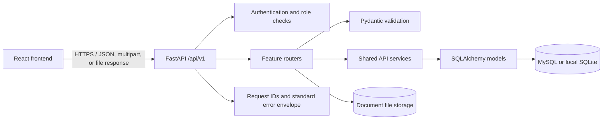

# Backend Architecture

## Purpose and scope

The backend provides the versioned API used by the React frontend. It handles identity and access, course and document services, document verification, moderation, and quizzes. The product requirements are in [LetLearnTogether_PRD_v3.md](../LetLearnTogether_PRD_v3.md) and [LetLearnTogether_SRS_v3.md](../LetLearnTogether_SRS_v3.md); the machine-readable API contract is [API_SPEC.yaml](./API_SPEC.yaml).

## Technology

- FastAPI exposes the HTTP API and generates interactive OpenAPI documentation.
- Pydantic validates request and response data.
- SQLAlchemy maps application entities to MySQL in shared environments; SQLite is the local-development default when no database host is configured.
- JWT bearer tokens authenticate protected requests. Passwords are hashed with bcrypt.
- Uploaded documents are stored outside the database; document metadata and storage paths are persisted in the database.

## Request flow

## Code organization

| Location | Responsibility |
| --- | --- |
| `backend/app/main.py` | FastAPI application, lifecycle, middleware, error handlers, and router registration. |
| `backend/app/core/config.py` | Environment-based configuration for database, signing key, uploads, CORS, and public URLs. |
| `backend/app/core/database.py` | SQLAlchemy engine, declarative base, and request-scoped database sessions. |
| `backend/app/core/security.py` | bcrypt password hashing and JWT creation/validation. |
| `backend/app/core/dependencies.py` | Authenticated-user dependency and role authorization. |
| `backend/app/models/` | SQLAlchemy persistence entities. |
| `backend/app/schemas/` | Request validation and response schemas. |
| `backend/app/routers/` | Feature-specific HTTP routes. |
| `backend/app/services/api.py` | Shared pagination, resource checks, response shaping, and transaction helpers. |
| `backend/tests/` | API integration tests. |

## Feature boundaries

- **Identity and access:** registration, login, current profile, user administration, JWT authentication, and role checks.
- **Courses:** public course discovery and admin-managed course records/lecturer assignment.
- **Documents:** upload, search, review, browsing, download, reporting, revocation, and QR verification.
- **Quizzes:** quiz authoring/publication, student submissions, server-side scoring, and attempt history.

The API is mounted at `/api/v1`. The interactive API documentation is served by FastAPI at `/docs`. In the production Compose stack, the React app is served by an unprivileged Nginx container, Caddy terminates HTTPS, and API/database/upload traffic stays on private Docker networks.

## Authorization principles

- Public registration creates Student accounts only. Elevated accounts must be created by an Admin or through the initial-admin bootstrap process.
- Lecturers may upload and remove their own course materials, review student documents, post announcements, and manage quizzes only for courses assigned to them. Lecturer-uploaded materials are immediately verified; Student submissions require review.
- Moderators can review documents, revoke stamps, delete content, and manage reports.
- Admins manage users and courses and have the administrative permissions specified by the API contract.
- Students can submit documents for review, view their own submission status, submit quiz attempts, and view their own attempt history.
- Public document browsing and file delivery expose verified documents only. A verification token continues to show a revoked stamp as Revoked.

## Persistence and migrations

The SQLAlchemy model definitions and [schema.sql](./schema.sql) must be kept aligned. Apply Alembic migrations explicitly; application startup does not create, migrate, or alter tables. Apply a reviewed database migration before deploying model changes to an existing MySQL database. Coordinate schema changes with the database team.

## Configuration and operation

Configuration is read from `backend/.env`; see [backend/.env.example](../backend/.env.example). Never commit a populated `.env`. Production must set a strong stable `SECRET_KEY`, a persistent MySQL connection, the public API base URL, allowed frontend origins, and durable upload storage. Production traffic must use HTTPS. Plan and test database backups and file-storage backups together.

## Known delivery boundaries

The current integration tests use SQLite. MySQL behavior, production deployment, durable object/file storage, migration execution, backup/restore, and production load/security checks require validation in their target environments before release.
